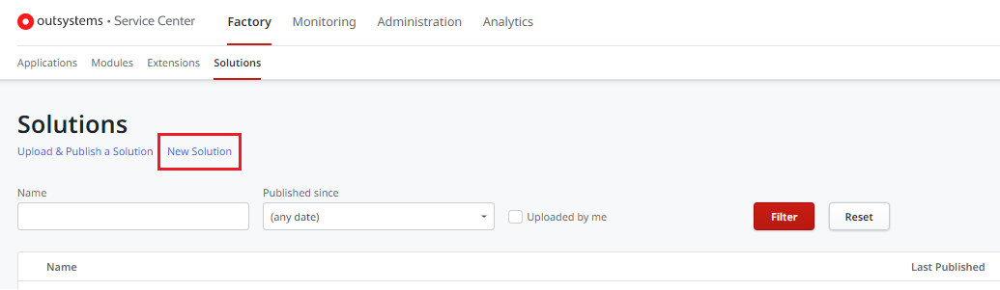
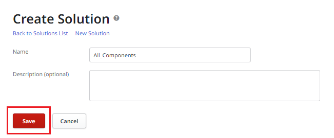
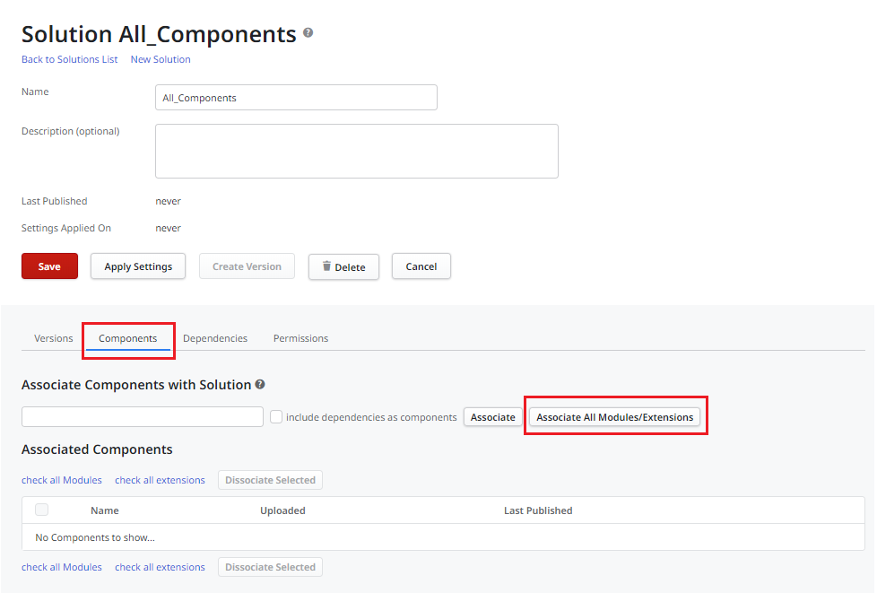
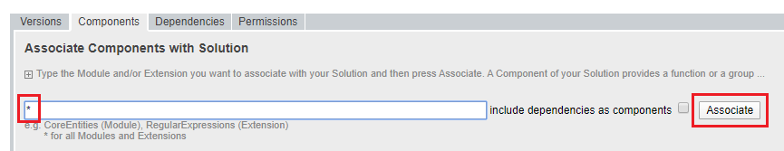
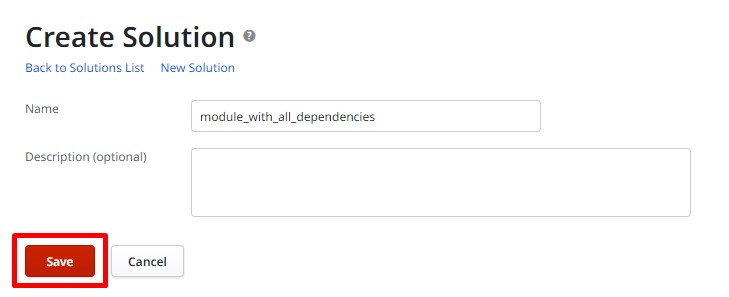
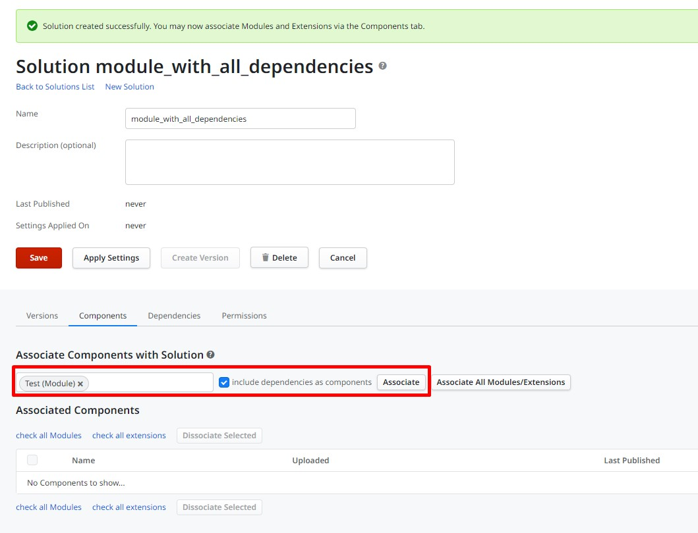
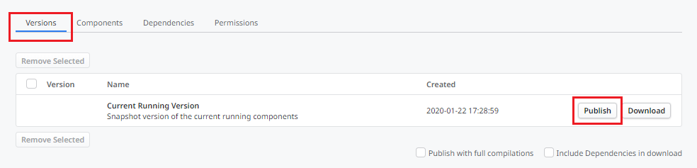
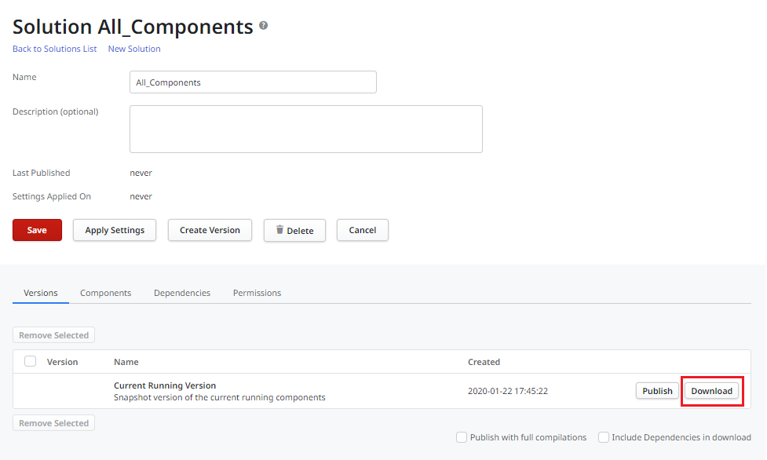

# Creating and using a solution

It's a common practice in OutSystems Factory management to create and use a solution. This is either a Factory solution containing all the components, a solution for a specific Module or an application with all its dependencies. You use a solution to:

* Refresh references in Environments used for development purposes.
* Republish application Modules after an update or upgrade.
* Troubleshoot some tasks.

For feature availability in different Environments, refer to [feature availability for different purposes](https://success.outsystems.com/Documentation/11/Setup_and_maintain_your_OutSystems_infrastructure/Setting_Up_OutSystems/Configure_your_OutSystems_environment#feature-availability-for-different-purposes).

A solution can also publish a version of a specific application to another Environment as an alternative to a LifeTime staging Environment. For example, an **All Components** solution publishes and deploys all associated components.

## Prerequisites

To create, publish, and download a solution, you need the **Administrator** role. For more information about roles, refer to [Understand the permission model for IT users](https://success.outsystems.com/documentation/11/managing_outsystems_platform_and_application_lifecycle/manage_it_users/understand_the_permission_model_for_it_users/).

## Create a solution with all components

If you don't have an **All Components** solution yet:

1. Go to Service Center at `https://ENVIRONMENT_URL/ServiceCenter`. Replace `ENVIRONMENT_URL` with the URL of your Environment.

1. Under **Factory** > **Solutions**, click the **New Solution** link.

    

1. Name the solution `All_Components` and click the **Save** button.

    

### Add the components

On the **All Components** solution screen:

1. Go to the **Components** tab.

1. Click the **Associate All Modules/Extensions** button.

    

    For previous versions of Service Center, type `*` and click the **Associate** button.

    

## Create a solution for a Module and all its dependencies

To create a solution for a Module and its dependencies, follow these steps:

1. Go to Service Center at `https://ENVIRONMENT_URL/ServiceCenter`.
1. Under **Factory** > **Solutions**, click the **New Solution** link.

    

1. Name the solution and click the **Save** button.

    

### Add the components

To add the Module and its dependencies to the solution, follow these steps:

1. Go to the **Components** tab.
1. Search for the Module name and select the **include dependencies as component** checkbox.
1. Click the **Associate** button.

    

### Publish or download the solution

Use the solution in one of the following ways:

* Whenever you want to **republish your whole factory**, click the **Publish** button for the **Current Running Version**.

    

* If you want to **deploy the whole solution to another Environment** or download the solution for **troubleshooting** purposes, click the **Download** button for the **Current Running Version** or any other version you created. Then, save the `.osp` file to your file system.

    

The publishing operation by itself doesn't impact application availability at runtime. However, consider any possible breaking changes (for example, after an upgrade or update) and broken references so that they don't affect the applications' behavior.

There's generally no need to create versions for this solution. If you do, remember that publishing a solution version can revert some applications to the version they were in when you created the solution version.

